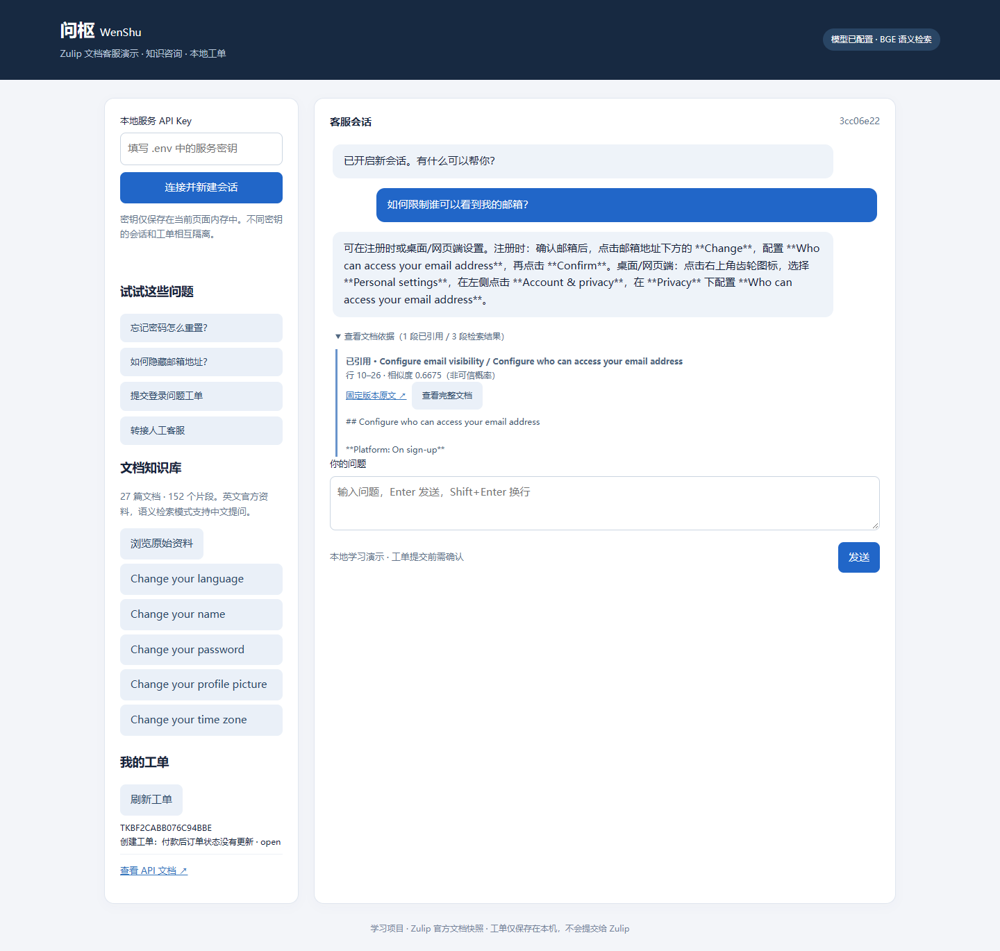
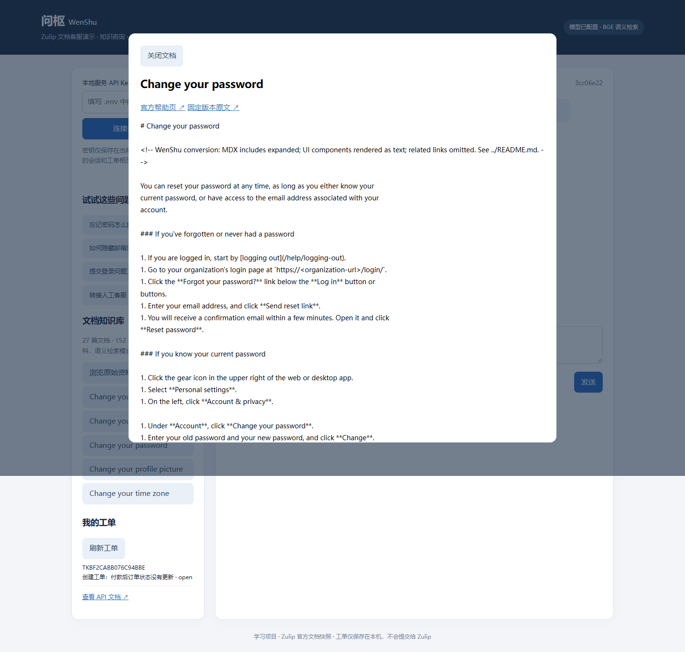

# 问枢 WenShu · 文档客服与工单助手

[](https://github.com/ahdauawa/wen-shu-agent/actions/workflows/tests.yml)

基于 **Python + FastAPI + LangGraph + BGE-M3 + Chroma + DeepSeek** 的学习项目。围绕 SaaS 帮助中心场景，连接文档问答、工单办理、低置信度澄清和人工交接。

知识库使用 **27 篇 Zulip 官方帮助文档、152 个检索片段**，覆盖账户、权限、通知、机器人和计费。英文原文保存在仓库，BGE-M3 支持中文跨语言检索，DeepSeek 根据检索证据生成中文回答。网页可浏览完整文档，回答下可查看引用章节、原文片段、行号和固定版本来源。

## 从哪里来的文档

- [可直接阅读的文档](knowledge/zulip/documents)；[来源及许可说明](knowledge/zulip/README.md)；[逐篇来源清单](knowledge/zulip/manifest.json)。
- 原始 MDX、引用片段和导航组件保存在 `knowledge/zulip/upstream/`，固定上游 Git commit，校验 Git blob 哈希。
- 转换器展开引用和操作步骤，按 Markdown 章节切分，窗口最多 **800 字符、重叠 100 字符**；不把引用片段或 chunk 数冒充文档数量。
- 使用 Apache-2.0 许可，保留原始 LICENSE/NOTICE；项目与 Zulip 无隶属关系。文档是 2026-10-13 快照，不保证后续计费政策不变。

## PyCharm 运行

需要 Python 3.11+，本机使用 Python 3.12。在项目根目录执行：

```powershell
python -m venv .venv
.\.venv\Scripts\python.exe -m pip install --no-cache-dir -r requirements.lock.txt
.\.venv\Scripts\python.exe -m pip install --no-build-isolation --no-deps -e .
.\.venv\Scripts\python.exe -m scripts.setup_local
```

安装向量检索依赖：

```powershell
.\.venv\Scripts\python.exe -m pip install --no-cache-dir -e ".[rag]"
```

修改本地 `.env`：

```dotenv
WENSHU_MODEL_MODE=openai
WENSHU_LLM_BASE_URL=https://api.deepseek.com/v1
WENSHU_LLM_MODEL=deepseek-chat
WENSHU_LLM_API_KEY=在本地填入自己的密钥
WENSHU_RETRIEVAL_MODE=chroma
WENSHU_KNOWLEDGE_SOURCE=documents
WENSHU_KNOWLEDGE_DIR=knowledge/zulip
WENSHU_EMBEDDING_MODEL=BAAI/bge-m3
WENSHU_EMBEDDING_CACHE_PATH=data/models
WENSHU_CHROMA_PATH=data/chroma
WENSHU_RETRIEVAL_THRESHOLD=0.58
```

`WENSHU_API_KEYS` 是网页访问本地服务的独立密钥，由 setup 脚本生成，不是 DeepSeek Key。不要把 `.env` 上传。模型名称可改为已下载的本地模型目录；BGE-M3 默认使用 CPU，首次需下载权重并建索引。

```powershell
.\.venv\Scripts\python.exe -m scripts.ingest_documents
.\.venv\Scripts\python.exe run.py
```

打开 http://127.0.0.1:8000，填写本地服务密钥，点击“连接并新建会话”，再点击“浏览原始资料”。PyCharm 解释器选择项目下的 `.venv/Scripts/python.exe`，工作目录设为项目根目录；可使用仓库中的 **WenShu RAG (DeepSeek)** 运行配置。

| 模式 | 实际行为 |
|---|---|
| offline + lexical | 规则分类、词项匹配、原文摘录；英文资料不支持可靠的中文词项匹配 |
| offline + chroma | BGE 跨语言检索，返回英文原文片段 |
| openai + chroma | 模型分类、BGE 检索、DeepSeek 中文生成与引用校验 |

## 可以演示的流程

1. 咨询“如何限制谁可以看到我的邮箱？”，展开文档依据并打开全文。
2. 输入“创建工单：无法收到登录邮件”，核对预览后输入“确认提交”。
3. 用返回的 TK 编号查询工单；相同 request_id 重试不会重复创建。
4. 输入“转人工”，查看交接记录。工单和人工交接仅保存在本机，没有向 Zulip 提交。

LangGraph 包含 classify、clarify、retrieve、tools、respond、handoff 六个节点。处理七类意图；最多澄清两轮。检索为空、证据不足或模型失败会转人工。生成结果必须携带实际检索 ID，缺失或虚构引用会被拒绝；这能保证引用存在，**不能自动证明回答每个事实都受引用支持**。

工单参数用 Pydantic 校验，写入前需要用户确认；SQLite 事务与请求唯一约束保证重试幂等。API Key 区分演示用户，会话和工单只能由所属用户访问。会话状态支持轮次之间恢复，不宣称图节点中途恢复。





## 添加和更新资料

把有权使用的 UTF-8 Markdown/TXT 放进 `knowledge/zulip/documents/`，需要公开来源时同步维护 manifest。再次执行 ingestion 命令并重启服务。索引名称包含文档内容、元数据和模型配置摘要，资料变化后不会查询旧集合；旧索引保留供本地排查，不会自动删除。后台服务需要重启才能载入新资料。

`python -m scripts.build_corpus` 可从固定上游快照重新生成附带文档；该操作会覆盖同名转换结果，自己的资料建议另起文件名。

## 测试与真实检索评估

```powershell
.\.venv\Scripts\python.exe -m unittest discover -s tests -v
.\.venv\Scripts\python.exe -m scripts.evaluate_documents
.\.venv\Scripts\python.exe -m scripts.evaluate_documents --with-llm
```

评测问题在 [document_queries.json](tests/fixtures/document_queries.json)，**不进入知识库**。42 条手工编写的中文问题，12 条用于阈值校准，30 条用于测试（24 条有答案、6 条无答案）。阈值只根据校准集确定，固定为本轮结果 **0.58**。

本机 BGE-M3 实测：

| 指标 | 实测结果 |
|---|---:|
| 文档数 / chunk 数 | 27 / 152 |
| 不加阈值的文档级 Recall@5 | 23/24，95.83% |
| 加阈值的文档级 Recall@5 | 21/24，87.50% |
| 测试无答案问题仍通过相似度阈值 | 1/6 |
| 测试有答案问题被阈值拒绝 | 2/24 |

这是小规模、人工编写、针对当前语料的检索测试；**文档命中不等于答案正确，也不等于命中了足够证据**。阈值对无答案问题的识别有限，生成阶段还会检查证据是否足够。完整逐题结果见 `docs/document-evaluation.json`，本地复测输出到 `reports/document-evaluation.json`。带 `--with-llm` 会请求已配置 API 并记录少量真实回答样例，有调用费用；样例不统计成“答案准确率”。

24 项本地自动测试通过，覆盖会话、工单、幂等重试、用户隔离、引用校验、证据不足交接和文档更新。真实 DeepSeek 样例已写入评测报告；其中 2 条生成了带引用的中文答案，3 条因检索证据未过阈值而拒答。

标注按预先指定的文档 ID 计算，可能漏标其他含相同答案的文档。例如密码重置题虽未命中预设的密码修改文档，却从登录帮助中检索到了相同操作步骤；报告保留原始标注，不回填测试分数。

原有 `app/data/faq.json` 和 `scripts/evaluate.py` 仅保留作离线流程回归测试；其中 12 条虚构 FAQ 不计入文档语料或上述指标。

## API 和代码导航

业务接口均要求 `X-API-Key`，交互文档见 http://127.0.0.1:8000/docs。

| 接口 | 功能 |
|---|---|
| GET /health | 运行模式、文档/片段数量、索引指纹 |
| GET /knowledge/documents | 文档清单和来源 |
| GET /knowledge/documents/{id} | 完整文档和版本信息 |
| POST /sessions、POST /chat | 新建会话、发送消息与路由 |
| GET /tickets、GET /tickets/{id} | 本人工单 |
| GET /handoffs、POST /feedback | 交接记录与回复评分 |

| 文件 | 阅读重点 |
|---|---|
| app/documents.py | 文件加载、分块、字符坐标与来源追溯 |
| app/knowledge.py | 向量索引、文档变更、阈值、同文档片段限额 |
| app/model.py | JSON 输出、引用约束、证据不足拒答、工具调用 |
| app/engine.py | LangGraph 路由、澄清上限、失败交接 |
| app/store.py、app/main.py | 权限归属、事务、幂等重试 |
| scripts/evaluate_documents.py | 校准与测试分离、检索指标及其局限 |

## 当前边界

仅监听本机；API Key 是演示身份，并非完整账号体系。SQLite 写事务覆盖整轮模型调用，慢请求会阻塞其他写操作，不适合据此宣称高并发。没有生产流量、真实人工坐席、线上 CSAT、500 篇 FAQ 或生产延迟数据。源文档中的链接指向未收录文章时，系统不会自动抓取；当前不支持 PDF/OCR。中英文检索存在漏召回，详情已保留在评测结果里。

模型服务接收提问、最近会话和检索片段；请用演示数据测试。`.env`、模型权重、数据库、运行日志不上传。提交记录使用真实开发时间。
