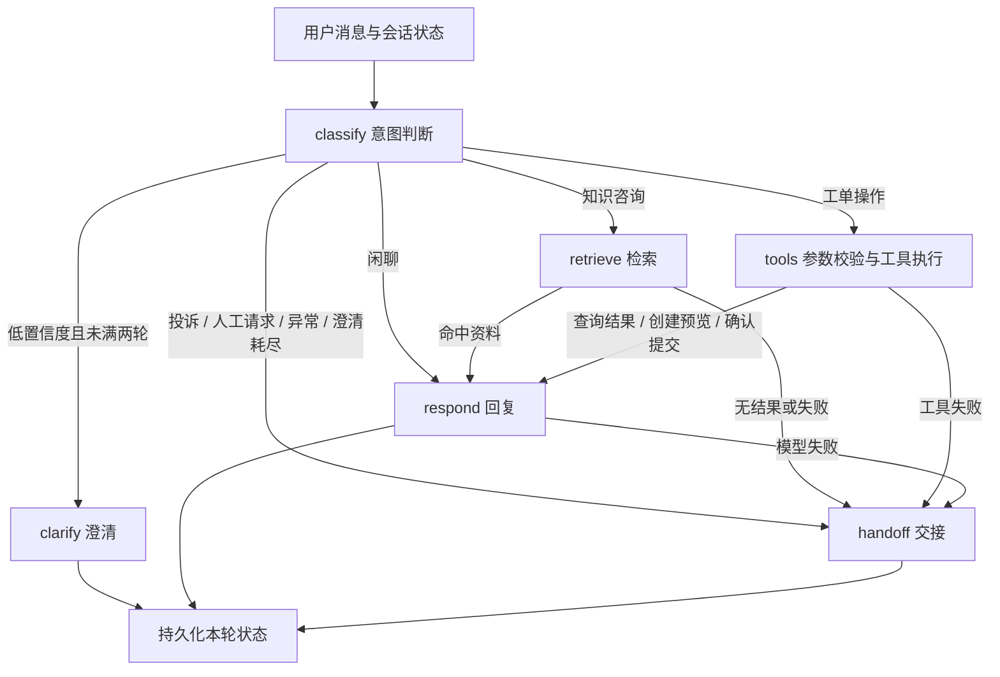

# 问枢 WenShu Agent

[](https://github.com/ahdauawa/wen-shu-agent/actions/workflows/tests.yml)

基于 **Python + FastAPI + LangGraph** 的客服分流与工单助手。把知识咨询、工单办理和人工交接放在同一条有状态对话流程中，提供可直接演示的网页和 REST API。

这是独立实现的学习原型。默认无需模型密钥，使用规则分类、词项检索和资料原文回复；配置兼容模型 API 后启用 LLM 意图判断、Function Calling 和回答生成，也可单独启用 BGE-M3 + Chroma 语义检索。

## 能演示什么

- 7 类意图：知识咨询、查询工单、创建工单、投诉、转人工、闲聊、未知；投诉和明确转人工优先处理。
- 低置信度最多澄清两轮，持续无法判断、检索无结果或模型异常时保存人工交接记录。
- 知识检索返回出处、匹配分数和处理节点轨迹；内置 12 条原创虚构 FAQ，便于复现实验。
- 工单创建先展示内容，用户确认后才写入 SQLite；同一个 `request_id` 重试不会重复创建工单。
- API Key 区分演示用户，服务端校验会话、工单和反馈的归属；工具参数通过 Pydantic 校验。
- SQLite 保存轮次状态、工单、交接摘要和反馈；关闭程序后会话数据仍在。

## 快速运行（Windows / PyCharm）

需要 Python 3.11+，本项目在 Python 3.12 验证。克隆后，在项目根目录执行：

```powershell
python -m venv .venv
.\.venv\Scripts\python.exe -m pip install --no-cache-dir -r requirements.lock.txt
.\.venv\Scripts\python.exe -m pip install --no-build-isolation --no-deps -e .
.\.venv\Scripts\python.exe scripts/setup_local.py
.\.venv\Scripts\python.exe run.py
```

打开 <http://127.0.0.1:8000>。从本地 `.env` 复制 `WENSHU_API_KEYS` 的值到网页，点击“连接并新建会话”。`.env` 由脚本生成随机密钥，已排除在 Git 之外；重复运行脚本不会覆盖配置。

PyCharm 选择 **Open → 项目目录**，解释器选 `.venv\Scripts\python.exe`。仓库提供 Windows 运行配置 **WenShu**，也可直接运行 `run.py`，工作目录设为项目根目录。出现项目信任提示时，核对目录后按 PyCharm 提示处理。Linux/macOS 使用 `.venv/bin/python`，其余命令相同。

### 一分钟演示

1. 输入“忘记密码怎么重置？”：查看回答来源和 `classify → retrieve → respond` 路径。
2. 输入“创建工单：付款后订单状态没有更新”：先得到内容预览，输入“确认提交”后生成工单编号。
3. 输入“查询工单 TK...”并替换为刚生成的编号：查看当前用户的工单状态。
4. 输入“转人工”：得到持久化交接记录。该会话结束后，点击连接按钮开始新会话。


## 对话流程



六个处理节点通过 LangGraph 条件路由连接。每轮结束后，API 层在同一 SQLite 事务内保存状态、工具写入和响应缓存；下一条消息继续读取会话状态。这里实现的是**轮次之间恢复**，没有宣称支持图节点中途断点恢复。

## 配置真实模型与语义检索

修改本地 `.env` 并重启服务：

```dotenv
WENSHU_MODEL_MODE=openai
WENSHU_LLM_BASE_URL=https://api.deepseek.com/v1
WENSHU_LLM_MODEL=deepseek-chat
WENSHU_LLM_API_KEY=填入自己的模型密钥
```

`openai` 表示兼容 Chat Completions 协议，服务需支持 JSON 输出和工具调用。每次请求有超时限制；工具只能查询当前用户的工单，或者准备待确认的创建参数。模型 API 会接收当前消息、最近会话及相关知识资料，请使用演示数据测试。

启用可选的 Chroma + BGE：

```powershell
.\.venv\Scripts\python.exe -m pip install --no-cache-dir -e ".[rag]"
```

```dotenv
WENSHU_RETRIEVAL_MODE=chroma
WENSHU_EMBEDDING_MODEL=BAAI/bge-m3
WENSHU_CHROMA_PATH=data/chroma
WENSHU_RETRIEVAL_THRESHOLD=0.18
```

首次启动会下载模型并建立本地索引，默认使用 CPU。安装扩展会额外安装 PyTorch 等依赖，需要预留磁盘、内存与下载时间。模型名称也可替换为已下载的本地目录。文档按 500 字符、50 字符重叠切分；集合名称包含模型与 FAQ 内容摘要，资料变化后会使用新索引。不同检索方式的分数不可直接比较，阈值应根据自己的验证集调整。

**验证范围：**当前已验证离线流程、网页交互和模型接口的模拟响应；真实远程 LLM 与 BGE-M3 模型下载/推理尚未完成实测。仓库没有将这部分标成已验收的性能结果。

## 测试与评估

```powershell
.\.venv\Scripts\python.exe -m unittest discover -s tests -v
.\.venv\Scripts\python.exe scripts/evaluate.py
.\.venv\Scripts\python.exe -m pip check
```

本地 18 项自动测试通过，覆盖澄清上限、人工分流、证据返回、创建确认与取消、并发重试幂等、跨用户访问、故障降级、状态恢复及工具参数校验。GitHub Actions 在提交后重新执行测试和离线评估。

评估脚本生成 `reports/offline-evaluation.json`，记录执行时间、逐条结果、意图准确率及本机延迟。基线数据仅含 **35 条手写意图冒烟用例**，检索使用 **12 条 FAQ 的原始问题**；当前两项均全部命中。这些样例用于检查流程可运行，不能代表真实用户泛化能力或 LLM 的效果，延迟也不是模型调用延迟。新增评估请采用独立问法、对抗样本和真实模型实测，不直接套用示例简历中的业务指标。

## API

接口文档：<http://127.0.0.1:8000/docs>。除首页和健康检查外，业务接口均要求 `X-API-Key` 请求头。

| 方法与路径 | 功能 |
|---|---|
| `GET /health` | 服务状态、模式和 FAQ 数量 |
| `POST /sessions` | 创建会话 |
| `GET /sessions/{session_id}` | 查询本人会话状态 |
| `POST /chat` | 发送消息、执行路由 |
| `GET /tickets` / `GET /tickets/{ticket_id}` | 查询本人工单 |
| `GET /handoffs` | 查询本人交接记录 |
| `POST /feedback` | 对本人的回复评分 |

`POST /chat` 示例请求体：

```json
{
  "session_id": "替换为创建会话返回的32位ID",
  "request_id": "4b067d17-834b-4a35-a01c-a7ae464646e6",
  "message": "退款申请多久处理？"
}
```

每条新消息生成新 UUID；网络失败重试原消息时使用相同 UUID。相同 ID 携带不同内容返回 409。创建工单只通过对话的“预览 → 确认”流程执行。

## 代码阅读与面试准备

| 文件 | 建议理解的问题 |
|---|---|
| `app/engine.py` | 条件路由如何工作？为什么限制澄清次数？哪些错误需要转人工？ |
| `app/model.py` | 模型输出为什么不能直接执行？参数和工单归属分别在哪里校验？ |
| `app/knowledge.py` | 词项检索与向量检索有什么区别？相似度阈值怎样影响拒答？ |
| `app/store.py` + `app/main.py` | 用户归属、唯一约束和事务怎样保证重试不会重复创建工单？ |
| `tests/test_app.py` | 如何构造并发重试、越权访问和模型超时场景？ |
| `scripts/evaluate.py` | 为什么小样本命中率不能等同于线上准确率？ |

### 当前边界

- 默认仅监听 `127.0.0.1`。API Key 是演示用户身份，不包含注册、JWT、密钥轮换或完整账户体系；更换密钥后会被视为新用户。
- SQLite 写事务覆盖整轮处理，模型较慢时会串行阻塞其他写请求。适合本地演示；扩展并发应改为按会话协调、数据库事务和可靠任务机制。
- 每个用户每分钟 120 次的限流在单进程内生效；当前不面向多副本部署。
- 人工交接只写入本地记录，尚未连接坐席系统。模型置信度是模型自评，未做概率校准。
- 不包含真实生产流量、付费订单、退款执行、线上 CSAT 看板或业务收益数据。
- `.env`、虚拟环境、SQLite 文件、模型缓存和评估运行输出均不上传。提交记录使用真实开发时间。

相关文档：[LangGraph](https://docs.langchain.com/oss/python/langgraph/overview)、[FastAPI](https://fastapi.tiangolo.com/)、[Chroma](https://docs.trychroma.com/)、[BGE-M3](https://huggingface.co/BAAI/bge-m3)。
